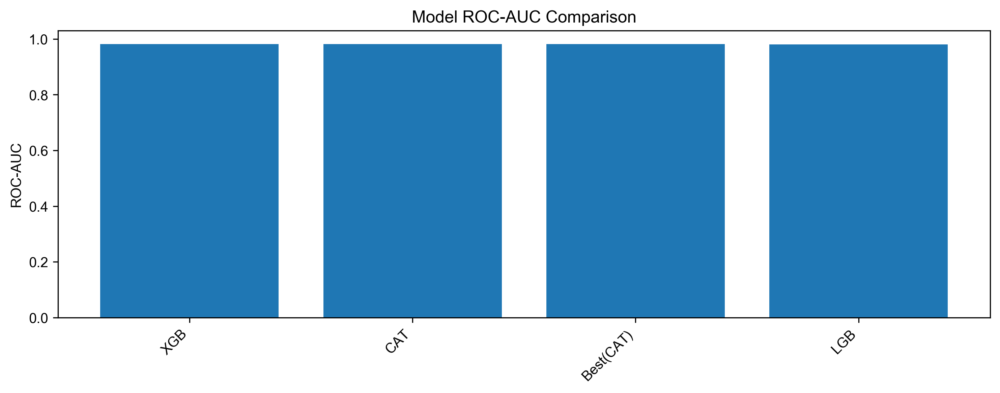

# PQC 网络流量异常检测

基于流量特征工程、LightGBM / XGBoost / CatBoost 对比实验和 SHAP 的机器学习研究项目。

## 已保存的实验结果

以下数值来自 `exp_figs/` 中的原始实验记录，属于 OOF 评估，本次发布未重新训练验证。

| 模型 | ROC-AUC | F1（阈值 0.5） | F1（选定阈值） |
| --- | --- | --- | --- |
| LightGBM | 0.980625 | 0.864999 | 0.879663 |
| XGBoost | 0.981307 | 0.874001 | 0.884936 |
| CatBoost | 0.981279 | 0.881145 | 0.885307 |

当前版本按 OOF F1 选择最佳单模型，没有执行模型融合。SHAP 代码使用 XGBoost 模型。



## 文件

- `baseline.ipynb`：数据探索、预处理、特征工程、参数优化、五折训练与结果分析。
- `utils/`：采样、优化和可视化工具。
- `ml_features_and_labels.csv`：原项目提供的特征表。
- `exp_figs/`、`paper_figs/`：已保存的实验图表，目录名称不代表已发表论文。
- `requirements.txt`：原项目依赖版本。

## 运行

建议使用 Python 3.10，在项目根目录执行：

```bash
python -m venv .venv
# 激活虚拟环境后：
pip install -r requirements.txt
pip install jupyter
jupyter notebook baseline.ipynb
```

按顺序运行 notebook。训练和参数搜索可能需要较长时间；依赖兼容性尚未在干净环境中验证。

## 说明

这是原始研究项目的首次整理发布。数据来源说明沿用 notebook，来源链接与数据许可仍待核实；此仓库暂未授予额外的代码或数据使用许可。OOF 结果不代表独立测试集或生产环境性能。阈值选择、数据划分和泛化能力仍有进一步验证空间。
